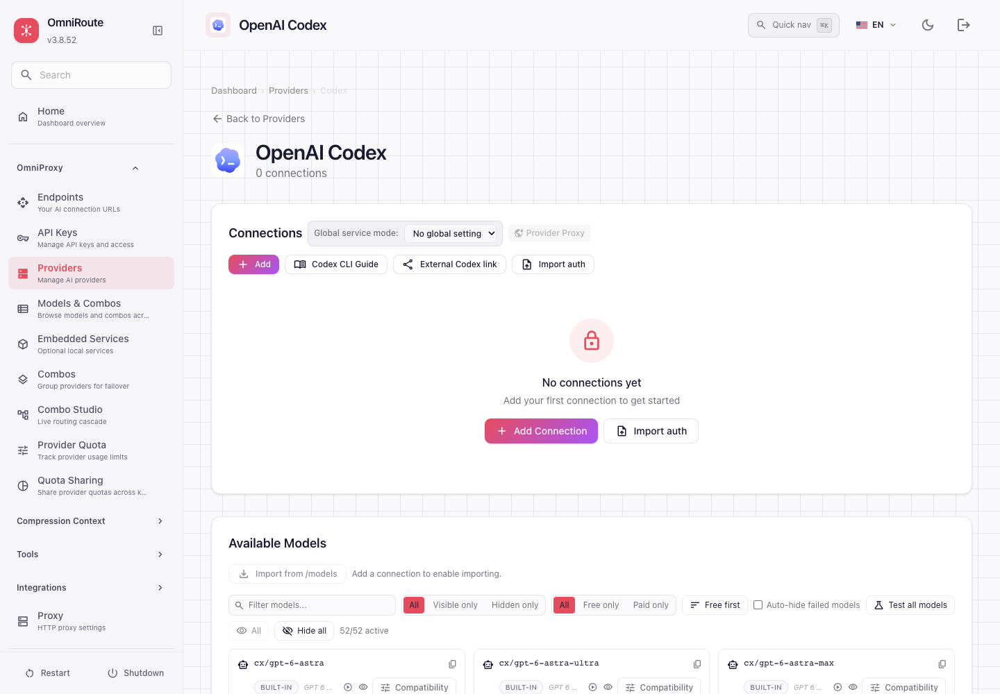

# OmniRoute + Codex Setup

**[Русская инструкция со скриншотами](docs/ru/guide.md) · [English guide with screenshots](docs/en/guide.md)**

Подключение Codex напрямую через `auth.json` / `config.toml`, установка OmniRoute и отдельный скилл для агента. Локальные чаты и архивы сохраняются; обновление provider IDs выполняется с резервной копией и только при остановленном клиенте.

Install OmniRoute, connect Codex directly through `auth.json` / `config.toml`, and let an agent use the bundled skill. Local chats and archives are retained through a backed-up, offline provider migration.



## Start / Начать

| RU | EN |
|---|---|
| [Полная установка и настройка](docs/ru/guide.md) | [Complete installation and configuration](docs/en/guide.md) |
| [Скилл установки для агента](skills/install-omniroute-codex/SKILL.md) | [Agent installation skill](skills/install-omniroute-codex/SKILL.md) |
| [Что проверено](docs/VALIDATION.md) | [Validation and limitations](docs/VALIDATION.md) |

```sh
git clone https://github.com/0xGunDone/omniroute-codex-setup.git
cd omniroute-codex-setup
uv run skills/install-omniroute-codex/scripts/setup.py --help
```

Helper requires Python3.11+ and [uv](https://docs.astral.sh/uv/getting-started/installation/). It uses pinned `tomlkit`. `server` creates a new loopback-only Docker installation. `client` defaults to preflight; writing requires `--apply`. Preflight includes one quota-consuming synthetic inference.

**Примеры / Examples**

- [auth.example.json](examples/auth.example.json) — only placeholder values; use your own router key.
- [config.example.toml](examples/config.example.toml) — merge settings; never replace a whole existing config.
- [model-catalog.example.json](examples/model-catalog.example.json) — native JSON structure; generate a complete catalog with the helper.
- [compose.example.yaml](examples/compose.example.yaml) — persistent storage, loopback binding and version pin.

Default: **`codex/gpt-6.1-sol` / `max`**. Existing sandbox, approvals, plugins and MCP settings are not relaxed. No shared accounts, real API keys, personal endpoints, chat history or production data are included.

**Compatibility:** model listings do not grant upstream access. Native image/search tools require compatible client and gateway builds; SQLite metadata is an internal, version-dependent interface. This is an independent community guide, not an official OmniRoute/OpenAI product. See both guides for limits and rollback.

## Development

```sh
uv run --with tomlkit==0.13.3 python -m unittest discover -s tests -v
```

Original helper/docs: MIT. OmniRoute and Codex retain their respective licenses; official model metadata is downloaded from a checksum-verified public commit, not bundled from a personal installation.
